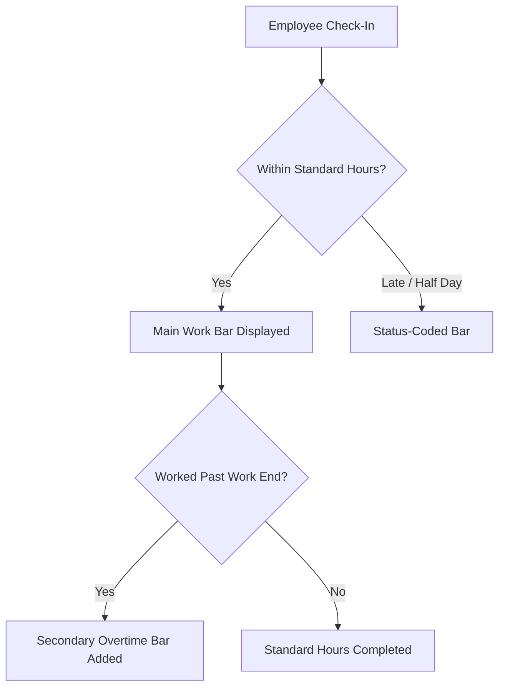

Monitoring and managing employee working hours is effortless with the Attendance dashboard. You can view daily timelines, track overtime, filter records by department or status, and quickly update attendance entries.

## Overview of Attendance Views

The attendance page splits your workforce into two main categories: employees who are currently checked in and those who are not in. 

| Section | Description |
|---------|-------------|
| **Checked in** | Displays employees who have recorded arrival times, complete with visual timelines and total hours worked. |
| **Not in** | Lists employees who are marked as Absent or on Leave for the selected day, along with any explanatory notes. |

---

## Navigating and Filtering Records

You can easily adjust the date you are viewing or narrow down the employee list to find specific records.

<Steps>
<Step title="Select a date">
Use the left and right arrows at the top of the page to move back and forth by a day, or click the date picker to jump directly to any calendar day.
</Step>
<Step title="Search for employees">
Type an employee's name, employee number, or department into the **Search** bar to instantly filter the list.
</Step>
<Step title="Filter by status or department">
Use the **Department** and **Status** dropdown selectors to view specific groups, such as seeing only employees who arrived **Late** or are on **Leave**.
</Step>
</Steps>

> [!TIP]
> If you have applied multiple filters and want to reset your view, simply click the **Clear filters** link next to the search bar.

---

## Understanding the Visual Timeline

For every checked-in employee, the dashboard displays a visual timeline tracking their working hours against standard company hours.

### Timeline Color Guide

- **Brand Color**: Standard present working hours.
- **Warning Color**: Late arrivals or delayed check-ins.
- **Info Color**: Half-day attendance records.
- **Secondary Color**: Overtime hours worked past the standard end time.
- **Faded Display**: Employees who are currently checked in but have not yet checked out.

---

## Editing Attendance Records

If an employee forgot to check in, or if you need to correct a status, you can edit attendance directly from the list without opening a popup modal.

<Steps>
<Step title="Select the employee row">
Click on any employee's row in the **Checked in** or **Not in** list to expand the inline record editor.
</Step>
<Step title="Modify details">
Update the employee's **Status**, **Check in** time, **Check out** time, or add a helpful note. 
</Step>
<Step title="Save changes">
Click **Save** to update the record. The system will automatically recalculate total hours worked and overtime.
</Step>
</Steps>

> [!WARNING]
> The system will prevent you from setting a check-out time that occurs earlier than the check-in time. Ensure your time entries are accurate before saving.

### Quick Actions for Absentees

If you need to quickly update your roster for the day, you can use the **Mark absentees present** button at the top right of the page. This automatically shifts all employees marked as **Absent** to **Present** for the selected day, saving you from editing each record individually.